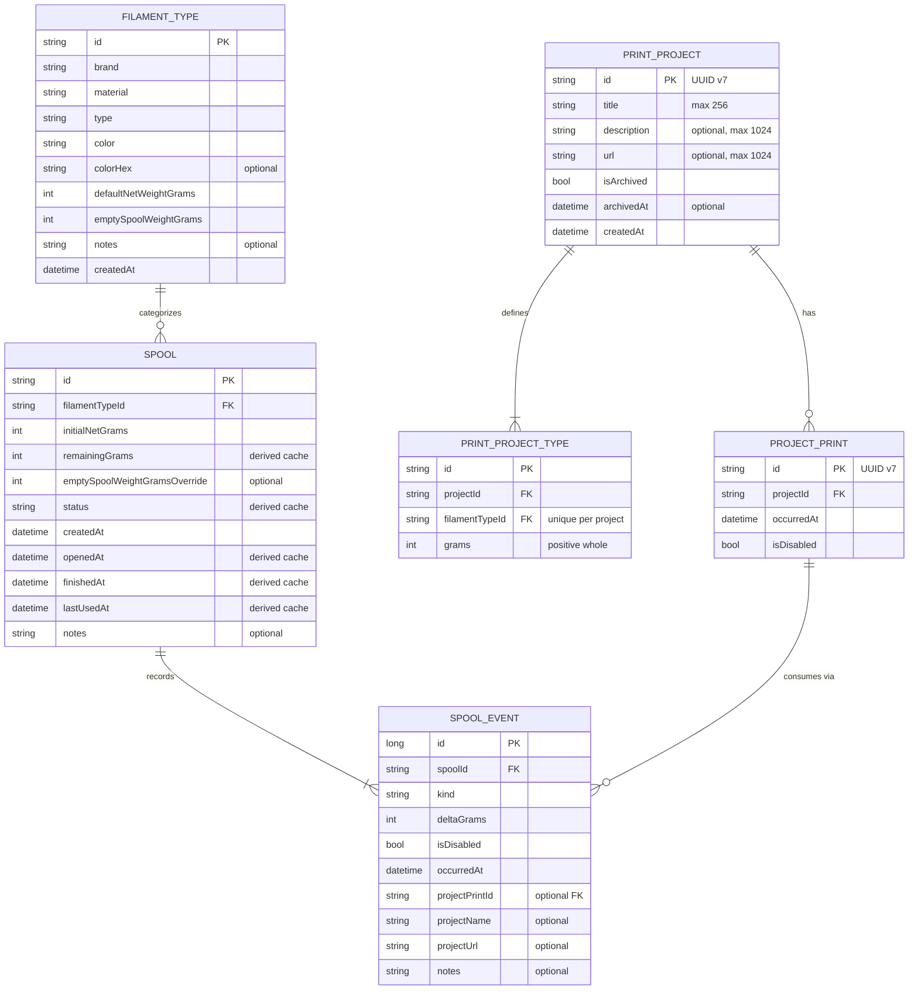
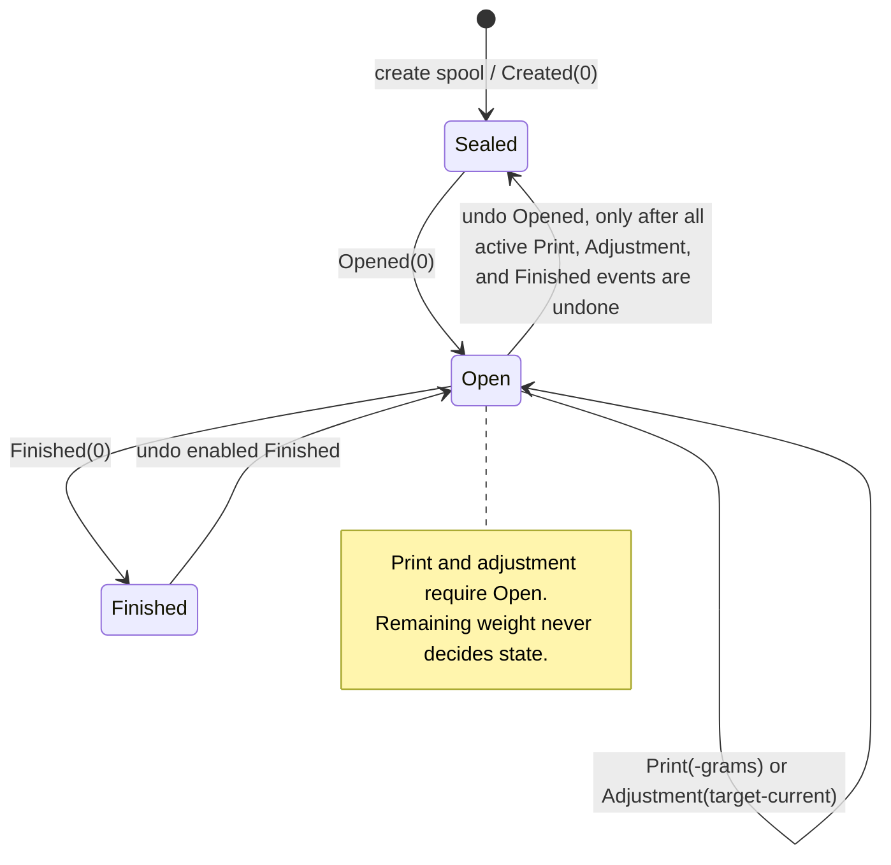

# Domain Model And Rules

## Inventory model

A filament type represents a product/category, not stock. Multiple physical spools can share it. A spool cannot outlive its type in normal application operations: type deletion is rejected while it has any spools. Deleting a spool is allowed and deletes its events through the database foreign-key cascade; this is intended only for an incorrectly created spool. A spool with any active event other than `Created` cannot be deleted (rejected with `409`, in the API as well as the UI), which includes any enabled project print; once every such event is undone, deleting the spool also deletes its undone project prints as a whole, including their undone events on other spools, and re-evaluates those spools.

Print projects reference filament types in the other direction: deleting a type is rejected (`409`) while any project definition lists it — the project must be archived and deleted first. Deleting a project cascades to its project prints; the linked spool events are deleted by the application before the prints, because the events' reference to a project print is restrictive.

All weights are integer grams. The database limits type IDs and spool IDs to eight characters although generated IDs have fixed shorter lengths. Notes are limited to 1,024 characters; a print project name is limited to 256 characters and its URL to 1,024 characters.

## Identifiers

Filament assigns random, uppercase identifiers and retries on the extremely unlikely collision before saving.

| Entity | Length | Alphabet | Capacity |
|---|---:|---|---:|
| Filament type | 3 | `0123456789ABCDEFGHJKMNPQRSTVWXYZ` | 32,768 |
| Spool | 4 | `0123456789ABCDEFGHJKMNPQRSTVWXYZ` | 1,048,576 |

Print projects and project prints do not use short display IDs; they are identified by UUID v7 (36-character, time-ordered) strings.

The alphabet is Crockford-Base32-like and omits visually confusing letters. For user-entered lookup normalization, whitespace, hyphens, and underscores are ignored; `I` and `L` normalize to `1`, `O` to `0`, and `U` to `V`. Stored/generated values are uppercase. Current HTTP path lookup uses the supplied ID directly, so API clients should send the stored canonical value.

## Weight rules

- A new spool's `initialNetGrams` is its requested initial net weight, or the owning type's default net weight when omitted.
- A spool's effective empty-spool weight is its own override when present; otherwise it is the type's empty-spool weight.
- `totalWeightGrams` exposed by the API is `remainingGrams + effectiveEmptySpoolGrams`.
- The type's default values are copied only as defaults at spool creation. Editing a type later does not change a spool's initial net weight. It does affect a spool's effective empty-spool weight where the spool has no override.
- Remaining grams are initialized from `initialNetGrams` and recalculated as that value plus the deltas of all enabled events. The persisted value is a recoverable read cache, not the source of truth.
- A print must consume a positive whole number of grams and cannot exceed the current remaining balance.
- A weighed adjustment accepts a non-negative target balance and records only the difference between that target and current balance. It may increase or decrease stock.
- Finishing is an explicit zero-gram marker. Reaching zero does not automatically finish a spool.

## Event history and lifecycle

Every spool is created with an enabled `Created` event with zero delta. It cannot be disabled. Events are evaluated chronologically by `occurredAt`; ties are ordered `Created`, `Opened`, `Print`/`Adjustment`, then `Finished`, with the event ID as the final tie-breaker.

For legacy resilience, evaluation treats an enabled print or adjustment encountered while sealed as opening the spool at that event's timestamp. Normal application actions do not rely on this behavior: users must open the spool first.

The most recent enabled event's `occurredAt` (in the chronological order above) is exposed as the spool's `lastUsedAt`. Because every spool has an immutable enabled `Created` event, `lastUsedAt` is never null: a spool with no other events reports its `CreatedAt`. Disabling the most recent event moves `lastUsedAt` to the now-most-recent enabled event; re-enabling it moves `lastUsedAt` back.

Undo and redo toggle `isDisabled`; they never erase an event. A disabled event remains visible in history, is displayed as undone, has no running balance, and contributes neither weight nor state. Redoing a print, adjustment, or finish requires at least one enabled `Opened` event. Undoing an opening is rejected until every active print, adjustment, and finish event has been undone. Open and finish reuse the most recent matching undone marker where possible.

The UI gives Finish visual emphasis at or below 5% of the initial net weight, but this is a presentation cue only.

## Lists, stock, and filtering

- Spool lists exclude finished spools by default; `includeFinished=true` includes them.
- The dashboard's active count and total remaining grams exclude finished spools. The finished count includes only finished spools.
- Daily consumption counts enabled print events only: a day's consumed grams are the sum of the prints recorded on that UTC day. Spool creation, weighed adjustments (in both directions), and finishes never count as consumed, even when they lower stock. The usage endpoint accepts 1-365 days (clamped) and the web dashboard requests 30; its per-day series is zero-filled and consecutive, so every day of the window is present, including days with no events.
- The dashboard's per-day total stock is the sum of remaining grams over all spools not finished at the end of each UTC day, reconstructed from each spool's entire enabled event history. A spool contributes nothing before its creation day and nothing from its finish day onward, where the remaining grams are treated as discarded — a finish lowers total stock by its finishing balance and never raises consumption. Spool creation, adjustments, finishes, undo, redo, and deletion shift or remove the stock line for the finish/affected day and every later day accordingly. See the completed [005 consumption graph](../done/005-consumption-graph/) change request.
- Types and spools support the same facets: brand, material, product type, and colour. Values selected within one facet are ORed; selections across facets are ANDed.
- Facet counts ignore their own facet's selection while applying all other selections. All values in the unfiltered universe are shown, including zero-count options, ordered by count descending then lexical value ascending.
- A spool inherits its facet attributes from its filament type. An unresolved type is omitted from a spool-list facet universe.
- The spool list is sorted server-side by a `sort` query parameter on `GET /api/spools` with values `lastUsed` (default), `leastRemaining`, or `mostRemaining`; missing or unknown values resolve to `lastUsed` without error. After the chosen key a fixed secondary order (`lastUsedAt` descending, then `id` ascending) keeps results stable. Sorting applies after facet filtering and does not change facet counts; finished spools, when included, sort by the same rules as active spools. See [Interfaces](interfaces.md#spool-list-sorting) and the completed [001-sorting](../done/001-sorting/) change request.

## Print projects

A print project is a reusable pattern for a known print: a required title (max 256 characters), an optional multi-line description (max 1,024), an optional URL (max 1,024), and one or more filament type lines, each with a positive whole number of grams. A type appears at most once in a definition; every other validation violation is rejected with a 400.

- **Effective date and list order.** A project's effective date is its `archivedAt` when archived, else its newest enabled project print, else its creation date; undone prints do not count. The list orders by the effective date, newest first, ties broken by title A–Z, then project ID. The ordering is computed in memory (single-user scale).
- **Editing.** Editing replaces title, description, URL, and the type lines. Type and grams changes affect only future prints (the pre-filled print-page values); existing project prints keep their recorded spools and grams. An archived project cannot be edited.
- **Archive and unarchive.** Archiving sets the archived flag and timestamp; unarchiving clears both. An archived project is read-only except for unarchiving: no printing, editing, or undo/redo of its prints.
- **Delete.** Only an archived project with no enabled project prints can be deleted. Deletion removes the project, all of its project prints (including undone ones), and the linked spool events; spool balances and history stay consistent afterwards.
- **Planning a print.** A print selection has exactly one slot per defined type (no skipping); every slot names a spool with at least 1 g. For each spool, the grams summed across all of its slots must not exceed its current remaining balance. Finished spools are rejected; a sealed spool is allowed and is opened by the print at the print's date/time through an explicit, ordinary `Opened` event that is not linked to the project print (so undoing or redoing the print never touches it, and the user can undo the opening separately on the spool page). The same spool may back several slots with separate grams, producing one print event per slot with the same date/time on that spool; the existing chronological tie-break order applies. All validation precedes any write, so a rejected print changes nothing.
- **Project prints and undo/redo.** A project print is created with the confirmation date/time and one `Print` event per slot; all events share that date/time and reference the print. Spool events linked to a project print cannot be undone or redone individually (the spool API rejects it with `400`); undo and redo exist only on the print project page. A project print is immutable once created. Undo disables the print and all of its linked spool events together: the spool history rows display as undone and the balances are restored. Redo re-enables them; if a spool lifecycle guard rejects the redo (for example, the spool's `Opened` event was undone in the meantime), a clear error is shown and nothing changes — the print stays undone.
- **Interaction with the rest of the ledger.** Project prints are ordinary enabled print events: they lower remaining grams, update the spool's `lastUsedAt`, and count toward the dashboard's 30-day consumption; undoing them removes them from consumption again.
- **Spool history integration.** A spool event created by a project print carries its project-print reference, and the spool event list resolves the owning project's ID. In the UI such rows display the project title as a link, are visually distinguished, and have no undo/redo controls — undo/redo of a project print exists only on the project page.

See the completed [008 print project](../done/008-print-project/) change request for the full specification and rationale.

## Derived-cache repair

`POST /api/spools/reevaluate` evaluates every spool from enabled events and saves only differences in status, remaining grams, opened timestamp, finished timestamp, and `lastUsedAt`. It is safe to run and is the supported repair operation after direct database work. It returns each corrected spool's old and new status and balance.
